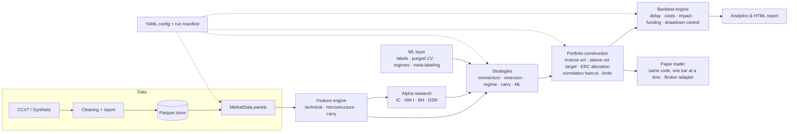

# AlphaForge

**A quantitative alpha research framework for crypto markets.**
Data ingestion → causal features → alpha discovery under multiple-testing control → strategy
families → risk-managed portfolio construction → event-loop backtesting with realistic frictions
→ walk-forward ML → paper trading on the same code path → reporting. Everything is driven by a
single typed configuration file and is reproducible down to the commit, seed and data hash.

🇫🇷 [Version française](README.fr.md) · 📐 [Architecture](docs/ARCHITECTURE.md) · 🔬 [Methodology](docs/METHODOLOGY.md) · 🤝 [Contributing](CONTRIBUTING.md)

[](https://github.com/theojoyerclement-crypto/alphaforge/actions/workflows/ci.yml)    

---

## What an employer should look at (10 minutes)

| Look at | Why it matters | Where |
|---|---|---|
| **Run one command** | Tests, a reference backtest and a paper-trading replay, offline, on any OS | `python scripts/smoke_test.py` |
| **Anti-look-ahead tests** | Future data is scrambled and every feature, strategy and the portfolio constructor must give the same past | `tests/test_features.py`, `tests/test_strategies.py`, `tests/test_live.py` |
| **Accounting identities** | `net = gross + funding − costs` checked against hand-computed books | `tests/test_backtest.py` |
| **Real-data results, including the bad ones** | Binance perps, net of fees, spread, impact and funding, compared with buy & hold | [Real data](#5-real-market-binance-usdt-m-perpetuals) |
| **A significant alpha that loses money** | t = 5.5, Sharpe +1.8 without frictions, −2.9 once costs and latency are charged | [Results §2](#results) |
| **ML that does not win** | Walk-forward ML loses to a carry rule, and the README says so | [Results §4](#results) |
| **Honest uncertainty** | Every portfolio Sharpe gets a paired block-bootstrap interval. On real data none is distinguishable from 0 or from BTC, and the README says so | [Noise](#how-much-of-this-is-noise) |
| **Backtest ↔ live parity** | The paper loop recomputes decisions bar by bar and matches backtest equity to 1e-10 | `alphaforge paper ... --replay N`, `src/alphaforge/live/` |
| **Configs** | One YAML file per experiment. Unknown keys are rejected and the error lists the allowed ones | `configs/`, `src/alphaforge/config/schema.py` |
| **Design rationale** | The choices that matter, written down | [ARCHITECTURE](docs/ARCHITECTURE.md#design-choices-that-matter-to-a-hiring-manager) · [METHODOLOGY](docs/METHODOLOGY.md#design-choices-that-matter-to-a-hiring-manager) |

## Why this exists

Most retail backtesters answer *"what would this strategy have earned?"*. AlphaForge is built to
answer the question a research desk actually asks: **"is this edge real, and does it survive
contact with execution?"** In practice, that means:

| Failure mode of naive backtests | How AlphaForge prevents it |
|---|---|
| Look-ahead bias | Every feature and rule-based strategy is **property-tested for causality**: the future is scrambled and the past must not change (`tests/test_features.py`, `tests/test_strategies.py`). |
| Same-bar execution | Signals at close *t* trade at close *t + delay* (`execution_delay: 1` by default). |
| Frictionless fills | Fees + half-spread + **square-root market impact** scaled by volatility and ADV; **perpetual funding** charged bar by bar. |
| Turnover measured on targets | Turnover is measured against **drifted** weights, which is what actually has to be traded. |
| Unfinished bars | The still-forming exchange candle is dropped at ingestion, so it never gets cached as a final close. |
| In-sample ML | Strategies that learn are **refused** outside walk-forward; each fold builds fresh models. |
| Label leakage in CV | **Purged K-fold + embargo** and **combinatorial purged CV** (López de Prado). |
| Data snooping across many alphas | **Newey-West** IC t-stats, **Benjamini-Hochberg** FDR control, **Deflated Sharpe Ratio**. |
| Backtest code ≠ live code | The paper trader calls the same strategies, portfolio constructor, cost model and mark-to-market function as the engine, and a test checks that both give the same equity. |
| Irreproducible results | Every run writes its resolved config, config hash, data hash, git commit (plus a dirty-tree flag), seed and package versions. |

## Results

Two kinds of evidence, kept apart on purpose:

* **Synthetic market (sections 1–4).** A deterministic perpetual-futures market (fat tails,
  GARCH volatility, regime switches, staggered listings) that **plants three weak, known edges**:
  time-series trend, 1-bar reversal and funding carry. It is an integration test with a known
  answer: a research stack that cannot rediscover planted edges, or that "discovers" absent ones,
  is broken.
* **Real market (section 5).** Binance USDT-margined perpetuals with real funding. This is where
  you find out what the planted edges were worth.

**1. Alpha research recovers what was planted and rejects what was not**
(`alphaforge research configs/multi_strategy.yaml`, 12 assets × 2000 daily bars, 15 candidates)

| Alpha | IC (1 bar) | NW t-stat | BH @10% | Deflated Sharpe | Verdict |
|---|---:|---:|:---:|---:|---|
| `reversal_1` | 0.039 | 5.5 | ✅ | 0.99 | planted ✔ |
| `basis_carry_5` | 0.022 | 3.1 | ✅ | 0.72 | planted ✔ |
| `funding_carry_21` | 0.018 | 2.7 | ✅ | 0.68 | planted ✔ |
| `mom_60` | 0.019 | 2.7 | ✅ | 0.26 | planted, weak ✔ |
| `low_vol_60` | 0.007 | 0.9 | ❌ | 0.00 | not planted ✔ |

**2. A significant alpha is not a tradable strategy** (`configs/cost_stress.yaml`, same reversal alpha)

| Execution assumption | Sharpe | CAGR |
|---|---:|---:|
| Frictionless, same-bar execution | **+1.83** | +39.4% |
| + fees, spread and square-root impact | −0.28 | −6.8% |
| + 1 bar of latency (default) | **−2.91** | −45.5% |

At ~460× annual turnover the edge is consumed by costs, and by the time the order is filled the
reversal has already happened. This is the single most common way backtests lie.

**3. Multi-strategy book** (`configs/multi_strategy.yaml`, net of every cost, Jul 2019 – Jun 2024)

| | CAGR | Vol | Sharpe | Sortino | Max DD | Turnover/yr |
|---|---:|---:|---:|---:|---:|---:|
| **Portfolio (risk parity, 20% vol target)** | **30.3%** | 21.0% | **1.37** | 2.08 | −18.2% | 168× |
| Funding carry | 36.3% | 16.0% | 2.02 | 3.10 | −15.2% | 51× |
| Cross-sectional momentum | 5.8% | 15.1% | 0.45 | 0.63 | −24.7% | 76× |
| Time-series momentum | 0.7% | 15.3% | 0.12 | 0.17 | −20.2% | 49× |
| Z-score mean reversion | −2.7% | 16.4% | −0.09 | −0.13 | −31.6% | 102× |
| Regime switching | −4.1% | 16.1% | −0.18 | −0.26 | −45.8% | 144× |

**4. Walk-forward ML** (`configs/ml_walk_forward.yaml`, 11 out-of-sample folds, models refit every 120 bars)

| Sleeve (out-of-sample only) | Sharpe | Turnover/yr | Note |
|---|---:|---:|---|
| Gradient-boosted direction model | −0.34 | 108× | no edge at 5 bars once costs are paid |
| Meta-labeled trend | 0.01 | 35× | in `examples/03`, cuts turnover ~14× and max drawdown ~5× vs. the unfiltered primary |
| GMM regime → strategy map | 0.31 | 117× | learns "reversion in the calmest regime, carry otherwise" |
| Funding carry (benchmark) | 0.70 | 54× | simple beats complex here |

These numbers are reported as they came out, without tuning: the ML sleeves do **not** beat a
simple carry rule on this data, and the framework says so.

> **Correction (Phase A audit).** The portfolio rows of tables 3 and 5 were first published with
> a risk-parity solver that **silently diverged** when sleeves were negatively correlated. It
> returned allocations such as 100% in one sleeve instead of equal risk contributions, and it
> put allocations more than 25 points away from ERC on 18% of `multi_strategy` bars and 1% of
> `binance_perps` bars. The solver is now a damped Newton method on the convex ERC
> formulation, with risk contributions equal to 1e-12 and a regression test on the failing
> case. Corrected portfolio rows: synthetic Sharpe
> 0.65 → **1.37**, because a real ERC diversifies the carry sleeve better. Binance Sharpe
> 0.42 → **0.35**, because the misallocated bars happened to be lucky, concentrated bets.
> Sleeve rows, alpha research, cost stress and walk-forward ML do not use the solver and are
> unchanged (walk-forward equity moves by < 1e-10). Portfolio rows have since moved again with
> the pre-registered drawdown overlay v2: see [Drawdown overlay v1 vs v2](#drawdown-overlay-v1-vs-v2).

### 5. Real market: Binance USDT-M perpetuals

`configs/binance_perps.yaml` is **unchanged since the initial commit**: it was not tuned on this
data. Universe: 12 large perps (BTC, ETH, SOL, BNB, XRP, ADA, DOGE, AVAX, LINK, DOT, LTC, ATOM),
daily bars, real 8-hourly funding, evaluation Jul 2021 – Oct 2026 (data through 2026-10-12),
default frictions (4 bps fee, 1.5 bps half-spread, square-root impact, 1 bar of latency).

| Net of all costs and funding | CAGR | Vol | Sharpe | Sortino | Max DD | Turnover/yr |
|---|---:|---:|---:|---:|---:|---:|
| **Portfolio (risk parity, 20% vol target)** | **9.0%** | 20.4% | **0.52** | 0.78 | −32.8% | 141× |
| Time-series momentum | 5.5% | 15.5% | 0.43 | 0.61 | −22.9% | 38× |
| Funding carry | 5.1% | 16.7% | 0.38 | 0.53 | −28.8% | 60× |
| Cross-sectional momentum | 2.1% | 17.0% | 0.21 | 0.29 | −30.7% | 91× |
| Regime switching | −11.5% | 16.1% | −0.68 | −0.93 | −49.9% | 113× |
| *Benchmark: BTC perp buy & hold* | *10.0%* | *52.2%* | *0.44* | | *−78.0%* | |
| *Benchmark: equal-weight long basket* | *−1.0%* | *68.4%* | *0.33* | | *−79.3%* | |

Portfolio by calendar year: 2021 H2 +10.5% · 2022 −17.3% · 2023 +24.7% · 2024 +26.2% ·
2025 +21.9% · 2026 YTD −9.9%. Annualised PnL attribution: price +17.1%, funding +2.2%,
**costs −8.6%**. The book is roughly market-neutral (average net exposure −0.02, gross 1.07,
daily correlation to BTC −0.10).

**5b. The same book on a point-in-time universe** (`configs/binance_perps_pit.yaml`). The
12-coin list above is hindsight: those coins are large today *because* they survived and went
up. This variant has the same strategies, frictions and dates. Each month it trades the 12
most liquid perps of that time, by trailing 30-day dollar volume after 90 days of trading.
The 29 candidates include coins listed later (APT, ARB, OP, SUI...) and **FTM, delisted in
January 2025**. Binance still serves flat, zero-volume FTM candles after the delisting. The
cleaner drops them as a dead feed, so FTM leaves the universe instead of becoming a
"riskless" asset with zero volatility.

| Net of all costs and funding | CAGR | Vol | Sharpe | Max DD | Turnover/yr |
|---|---:|---:|---:|---:|---:|
| **Portfolio (default overlay, v2)** | **−3.3%** | 19.0% | **−0.08** | −42.7% | 111× |
| Portfolio, overlay v1 (trapped) | −4.5% | 6.9% | −0.63 | −29.5% | 25× |
| Portfolio, overlay off | −5.1% | 20.6% | −0.15 | −49.9% | 123× |
| Time-series momentum | 5.0% | 15.3% | 0.39 | −20.4% | 35× |
| Cross-sectional momentum | 1.1% | 15.2% | 0.15 | −21.8% | 65× |
| Funding carry | −5.7% | 15.0% | **−0.32** | −41.3% | 47× |
| Regime switching | −11.5% | 15.7% | −0.70 | −50.4% | 102× |

What this does and does not show:

* **Selection hindsight looks worth about 0.6–0.7 of Sharpe, but this is not established.**
  With the overlay off, the portfolio goes from +0.53 on the hindsight universe to −0.15
  point-in-time. The paired 95% interval of the gap is [−0.05, 1.30]. Funding carry turns from
  +0.38 to −0.32, and only time-series momentum holds up (0.43 → 0.39). The headline number is
  the point-in-time one.
* **Nothing here beats holding BTC in a way that can be trusted.** On the flattering universe,
  the book's Sharpe (0.52) is a little above BTC's (0.44), with a −33% drawdown instead of
  −78% and close to zero beta. The paired interval of the gap is [−1.17, 1.31]. On the
  point-in-time universe the Sharpe is negative. See [How much of this is noise?](#how-much-of-this-is-noise).
* **Costs take about half of the gross price edge.** The framework charges them, which is the
  point.
* On real data the alpha leaderboard keeps funding-based signals (`funding_reversal_90`
  t = 3.4, `funding_carry_21` t = 2.0, both BH-significant) and rejects 60-day momentum (t = 0.04).
  `low_vol_60` has the largest rank IC (t = 8) but a **negative** long-short Sharpe. The IC
  weights every day equally, while dollar PnL is dominated by the few high-dispersion days when
  volatile alts rally. A rank IC is not a PnL.
* **Caveats.** Coins that Binance no longer serves at all (LUNA, MATIC...) cannot be
  candidates, so survivorship is reduced, not removed. The test covers one venue and a single
  path, with no capacity analysis. Treat it as a pipeline sanity check on real data, not as a
  track record.

### Drawdown overlay v1 vs v2

The v1 overlay measured drawdown on the equity it produced itself. Once it had cut exposure,
that equity stopped moving and the drawdown froze. The 5b book stayed at 5–10% exposure for
four years. The fix was **pre-registered** in [METHODOLOGY §6](docs/METHODOLOGY.md#6-pre-registered-change-drawdown-overlay-v2-2026-10-13),
committed (`cc2ba29`) before any of the numbers below were computed. v2 measures drawdown on
a **shadow book**: the same targets at full exposure, with the same costs and funding. The
thresholds are unchanged (15% / 30% / 20 bars). v1 remains available as
`risk.drawdown_basis: realized` and reproduces the earlier tables exactly.

| Portfolio Sharpe (max DD) | v1 (realized) | **v2 (shadow, default)** | overlay off |
|---|---:|---:|---:|
| Synthetic multi-strategy | 1.37 (−18.1%) | **1.37 (−18.2%)** | 1.38 (−17.8%) |
| Binance, fixed universe | 0.35 (−27.7%) | **0.52 (−32.8%)** | 0.53 (−31.2%) |
| Binance, point-in-time | −0.63 (−29.5%) | **−0.08 (−42.7%)** | −0.15 (−49.9%) |
| Walk-forward ML book | −0.13 (−25.9%) | **−0.05 (−29.7%)** | 0.19 (−26.9%) |
| Mean exposure multiplier (PIT) | 0.24 | **0.89** | 1.00 |

As reported, without further tuning:

* **The trap is gone.** In the point-in-time run, mean exposure goes from 0.24 to 0.89 and
  the share of bars below half exposure from 85% to 11%.
* **v2 shows no demonstrable value over having no overlay at all.** The gaps are not
  significant on Binance, and v2 is significantly *worse* on the ML book (−0.24 [−0.45,
  −0.03]). v2 vs v1 is not significant either, even point-in-time (+0.54 [−0.17, 1.25]).
* **v1's low drawdowns were an artefact.** It was out of the market. v2 does **not** cap the
  book's drawdown at the 30% hard limit, because that limit applies to the shadow book's
  drawdown: max DD reaches −33% on the fixed universe and −43% point-in-time.
* Any further change to the overlay needs a new pre-registration.

### How much of this is noise?

Paired 95% block-bootstrap intervals, using a method fixed beforehand
([METHODOLOGY §7](docs/METHODOLOGY.md#7-confidence-intervals-on-published-sharpe-ratios)).
Reproduce with `python examples/05_sharpe_confidence.py`.

| Portfolio Sharpe, 95% interval | v2 (default) | overlay off | BTC buy & hold |
|---|---:|---:|---:|
| Synthetic multi-strategy | **1.37 [0.60, 2.12]** | 1.38 [0.61, 2.13] | |
| Walk-forward ML book | −0.05 [−1.04, 0.99] | 0.19 [−0.82, 1.24] | |
| Binance, fixed universe | 0.52 [−0.28, 1.32] | 0.53 [−0.25, 1.34] | 0.44 [−0.39, 1.28] |
| Binance, point-in-time | −0.08 [−0.89, 0.73] | −0.15 [−0.96, 0.65] | 0.44 [−0.39, 1.28] |

| Paired difference in Sharpe | Estimate [95%] | Excludes 0? |
|---|---:|:---:|
| Binance fixed: v2 − BTC | +0.08 [−1.17, 1.31] | no |
| Binance PIT: v2 − BTC | −0.53 [−1.72, 0.65] | no |
| Binance v2: fixed − point-in-time universe | +0.61 [−0.05, 1.30] | no (borderline) |
| Binance fixed: v2 − v1 | +0.17 [−0.09, 0.44] | no |
| Binance PIT: v2 − v1 | +0.54 [−0.17, 1.25] | no |
| Binance fixed: v2 − off | −0.01 [−0.13, 0.12] | no |
| Binance PIT: v2 − off | +0.07 [−0.12, 0.27] | no |
| Walk-forward ML: v2 − off | −0.24 [−0.45, −0.03] | **yes** |
| Synthetic: v2 − off | −0.01 [−0.02, −0.00] | **yes** (tiny) |

The verdict, stated plainly:

* **On real data, no Sharpe in this repository is distinguishable from zero, or from BTC.**
  Five years of daily returns give intervals about ±0.8 wide. The only significantly positive
  Sharpe is on the synthetic market, where the edges were planted.
* **The hindsight-universe effect is large but not established** (+0.61, interval just
  touching zero).
* **Overlay v2 is not shown to beat v1.** Where the overlay differs significantly from no
  overlay at all, it is *worse* (ML book −0.24; synthetic −0.01). Its case rests on not
  trapping the book, not on adding Sharpe.

## Quickstart

macOS / Linux:

```bash
git clone https://github.com/theojoyerclement-crypto/alphaforge.git alphaforge && cd alphaforge
python3 -m venv .venv && source .venv/bin/activate
pip install -e ".[all]"                   # or: pip install -r requirements-dev.txt
python scripts/smoke_test.py              # tests + reference backtest + paper replay
```

Windows (PowerShell). Use `python`, not `python3`, which on Windows is the Microsoft Store stub:

```powershell
git clone https://github.com/theojoyerclement-crypto/alphaforge.git alphaforge; cd alphaforge
python -m venv .venv; .venv\Scripts\Activate.ps1    # cmd.exe: .venv\Scripts\activate.bat
pip install -e ".[all]"
python scripts/smoke_test.py
```

`scripts/smoke_test.py` runs the test suite, then `configs/multi_strategy.yaml`, then a 10-bar
paper-trading replay. It prints the path of the HTML report (`runs/<timestamp>_multi_strategy/report.html`)
and exits non-zero on any failure. Use `--quick` to skip the tests. The individual commands:

```bash
pytest                                                # 195 tests, ~2 min
alphaforge list                                       # strategies, features, alphas
alphaforge research configs/multi_strategy.yaml       # alpha leaderboard
alphaforge run configs/multi_strategy.yaml            # backtest + HTML report in runs/
alphaforge run configs/ml_walk_forward.yaml           # walk-forward ML book
alphaforge run configs/multi_strategy.yaml --set portfolio.target_vol=0.15 --set costs.fee_bps=2
alphaforge paper configs/multi_strategy.yaml --replay 20   # paper loop vs backtest parity
```

Without installing the package, prefix with `PYTHONPATH=src python -m alphaforge ...`
(PowerShell: `$env:PYTHONPATH="src"; python -m alphaforge ...`).

### Real data (run it yourself)

Needs `pip install ccxt` (included in `.[all]`) and network access to Binance's public endpoints.
No API key is required: only public market data is downloaded.

```bash
alphaforge fetch --exchange binance --timeframe 1d --start 2021-01-01 --symbols \
  BTC/USDT:USDT ETH/USDT:USDT SOL/USDT:USDT BNB/USDT:USDT XRP/USDT:USDT ADA/USDT:USDT \
  DOGE/USDT:USDT AVAX/USDT:USDT LINK/USDT:USDT DOT/USDT:USDT LTC/USDT:USDT ATOM/USDT:USDT
alphaforge run configs/binance_perps.yaml --set data.end=2026-10-12      # the table above
alphaforge research configs/binance_perps.yaml --set data.end=2026-10-12
alphaforge run configs/binance_perps.yaml                                # up to the last closed bar

# 5b, point-in-time universe: 17 more candidates, then the PIT run
alphaforge fetch --exchange binance --timeframe 1d --start 2021-01-01 --end 2026-10-12 --symbols \
  NEAR/USDT:USDT FIL/USDT:USDT APT/USDT:USDT ARB/USDT:USDT OP/USDT:USDT SUI/USDT:USDT \
  INJ/USDT:USDT AAVE/USDT:USDT UNI/USDT:USDT ETC/USDT:USDT BCH/USDT:USDT TRX/USDT:USDT \
  SAND/USDT:USDT AXS/USDT:USDT ICP/USDT:USDT 1000SHIB/USDT:USDT FTM/USDT:USDT
alphaforge validate configs/binance_perps_pit.yaml --set data.end=2026-10-12   # quality flags
alphaforge run configs/binance_perps_pit.yaml --set data.end=2026-10-12
```

Expect about 1 minute of downloading. `data/store/ccxt_binance_swap/<symbol>/` then holds
`1d.ohlcv.parquet` and `events.funding.parquet`, each with a JSON sidecar recording the row
count, date range and content hash. Each run directory `runs/<timestamp>_binance_perps/`
contains `report.html`, `metrics.csv`, `pnl_attribution.csv`, `cleaning_report.csv` and a
`manifest.json` with the data hash. The run reads the local store after the first download.
Add `--set data.source=parquet` to guarantee that it stays offline. Binance data is accessible
from most, but not all, jurisdictions.

### Paper trading

```bash
alphaforge paper configs/multi_strategy.yaml --replay 20    # offline demo + parity check
alphaforge paper configs/binance_perps.yaml                 # one live step on fresh data
```

`PaperTrader` (`src/alphaforge/live/`) runs the backtest's own strategies, `PortfolioConstructor`
and drawdown overlay on data up to the latest **closed** bar. It then trades the target decided
`execution_delay` bars ago through a `Broker`.

* `--replay N` walks the last N bars one at a time. At each bar it sees only the past, as it
  would live, and it fails if the resulting NAV differs from `BacktestEngine` over the same bars.
* The default mode is one step per call, meant to be scheduled once per bar (cron or Task
  Scheduler). It refreshes the data, marks the account to market, trades, and appends to
  `paper/<experiment>/{state.json, fills.csv, equity.csv}`. A second call on the same bar does
  nothing.
* `PaperBroker` fills at the close with the backtest's cost model. A real venue adapter would
  implement the same three-method `Broker` interface (`sync`, `execute`, `nav/weights`).
  Nothing upstream would change. Strategies that learn are not supported yet, because they
  need persisted, versioned models.

### Python API

```python
from alphaforge.config import load_config
from alphaforge.research import run_experiment

result = run_experiment(load_config("configs/multi_strategy.yaml"))
print(result.summary())                    # portfolio + every sleeve
result.portfolio.pnl_attribution()         # price vs funding vs costs
result.targets.allocation.tail()           # time-varying risk-parity weights
```

Worked examples live in [`examples/`](examples): quickstart, alpha research, ML with purged CV and
meta-labeling, and writing your own strategy in about 20 lines.

## Architecture



| Package | Responsibility |
|---|---|
| `alphaforge.data` | CCXT ingestion (OHLCV + funding, paginated, retried, unfinished bar dropped), synthetic market generator, auditable cleaning, Parquet store with hashed metadata, aligned `MarketData` panels |
| `alphaforge.features` | Registry of 21 causal features: momentum, volatility estimators (Parkinson, Garman-Klass), RSI, efficiency ratio; microstructure proxies (Amihud, Roll, Corwin-Schultz, Kyle λ, close-location); funding and basis carry |
| `alphaforge.alpha` | 15-alpha library, rank IC and decay, quantile spreads, turnover, Newey-West, PSR/DSR, MinTRL, Benjamini-Hochberg, causal IC-weighted alpha combination |
| `alphaforge.strategies` | `ts_momentum`, `xs_momentum`, `zscore_reversion`, `st_reversal`, `regime_switching`, `funding_carry`, `alpha_composite`, `ml_directional`, `meta_labeled`, `ml_regime` |
| `alphaforge.portfolio` | EWMA risk, inverse-vol sizing, ex-ante volatility targeting, ERC risk parity, correlation haircut, position/gross/net limits, drawdown controller, fractional Kelly |
| `alphaforge.backtest` | Event-loop engine, linear and square-root impact cost models, walk-forward runner, purged & combinatorial purged K-fold |
| `alphaforge.ml` | Fixed-horizon and triple-barrier labels, pooled LightGBM/sklearn direction model, meta-labeling with bet sizing, GMM and volatility regimes |
| `alphaforge.analytics` | Sharpe, Sortino, Calmar, profit factor, VaR/CVaR, tail ratio, drawdown episodes, monthly table, plots, self-contained HTML report |
| `alphaforge.research` | `run_experiment` / `run_alpha_research`: config → results directory with manifest |
| `alphaforge.live` | `PaperTrader`, the `Broker` interface and `PaperBroker`: the research code driving an account bar by bar, with state that survives restarts |

## Configuration

One YAML file describes an experiment end to end. Unknown keys are rejected, so typos fail loudly
and the error message lists the valid keys. Strategy names and parameters are checked before any
data is downloaded.

```yaml
name: multi_strategy
data:      {source: synthetic, symbols: [BTC, ETH, SOL, ...], timeframe: 1d}
strategies:
  - {name: ts_momentum, params: {lookbacks: [20, 60, 120]}}
  - {name: funding_carry, params: {lookback: 21, quantile: 0.3}}
portfolio: {allocation: risk_parity, sleeve_target_vol: 0.15, target_vol: 0.20, max_position: 0.30}
risk:      {max_drawdown: 0.30, drawdown_soft_limit: 0.15, cooldown_bars: 20}
costs:     {model: sqrt_impact, fee_bps: 4.0, half_spread_bps: 1.5, impact_coefficient: 0.1}
backtest:  {execution_delay: 1, apply_funding: true, start: "2019-07-01"}
walk_forward: {enabled: false, train_bars: 750, test_bars: 120, embargo_bars: 10}
```

```text
$ alphaforge run my.yaml
error: my.yaml: 1 invalid setting(s)
  - portfolio.target_volatility: unknown key (allowed: vol_halflife, sleeve_target_vol, allocation, ..., target_vol, ...)
```

Each run writes `runs/<timestamp>_<name>/` containing `report.html`, `metrics.csv/json`,
`pnl_attribution.csv`, `drawdowns.csv`, `monthly_returns.csv`, `allocation.csv`, time series and
positions, `cleaning_report.csv`, `config.json`, `manifest.json` and `run.log`.

## Extending

```python
from alphaforge.strategies import Strategy, register_strategy
from alphaforge.features import compute_feature

@register_strategy
class FundingSqueeze(Strategy):
    name, family = "funding_squeeze", "carry"

    def __init__(self, lookback: int = 7) -> None:
        self.lookback = lookback

    def generate_signals(self, data):
        funding = compute_feature("funding_rate", data, lookback=self.lookback)
        trend = compute_feature("vol_adj_momentum", data, lookback=30)
        return self.finalize(((funding < 0) & (trend > 0)) * 1.0, data)
```

The strategy is now usable from YAML (`- name: funding_squeeze`), and the causality and bounds
tests pick it up automatically. New features use `@register_feature` the same way. See
[CONTRIBUTING.md](CONTRIBUTING.md).

## Project layout

The repository and the Python package are both called `alphaforge`. A local checkout may live
in a folder with another name; that has no effect.

```
src/alphaforge/   data · features · alpha · strategies · portfolio · backtest · ml · analytics · research · live · config · utils
configs/          multi_strategy · ml_walk_forward · binance_perps · cost_stress
examples/         01_quickstart · 02_alpha_research · 03_ml_meta_labeling · 04_custom_strategy · 05_sharpe_confidence
scripts/          smoke_test.py (one-command check)
tests/            195 tests: causality properties, hand-computed accounting, CV leakage, paper/backtest parity, end-to-end runs
docs/             ARCHITECTURE.md · METHODOLOGY.md
```

## Roadmap

- Longer or broader real-data samples (more venues, 4h bars): at ±0.8 of Sharpe, five years of daily data cannot separate the books tested here
- Capacity analysis: Sharpe as a function of AUM under the impact model
- Live venue adapter (CCXT orders, balance reconciliation, kill switch) behind the existing `Broker` interface
- Persisted, versioned models so walk-forward ML strategies can be paper-traded
- Delisted-instrument history from a second source, to remove the survivorship that remains in 5b
- Order-book data (L2 snapshots) for true microstructure features and spread-aware execution
- Hierarchical risk parity and covariance shrinkage (Ledoit-Wolf) in allocation

## License and disclaimer

[MIT](LICENSE). This is research software and nothing here is investment advice. Synthetic-data
results demonstrate the methodology. The real-data results are a single, survivorship-biased
backtest, not a track record.
