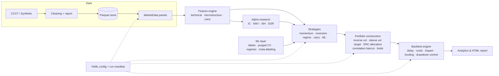

# AlphaForge

**A quantitative alpha research framework for crypto markets.**
Data ingestion → causal features → alpha discovery under multiple-testing control → strategy
families → risk-managed portfolio construction → event-loop backtesting with realistic frictions
→ walk-forward ML → reporting, all driven by a single, typed configuration file and reproducible
down to the commit, seed and data hash.

🇫🇷 [Version française](README.fr.md) · 📐 [Architecture](docs/ARCHITECTURE.md) · 🔬 [Methodology](docs/METHODOLOGY.md)

  

---

## Why this exists

Most retail backtesters answer *"what would this strategy have earned?"* AlphaForge is built to
answer the question a research desk actually asks: **"is this edge real, and does it survive
contact with execution?"** Concretely, that means:

| Failure mode of naive backtests | How AlphaForge prevents it |
|---|---|
| Look-ahead bias | Every feature and rule-based strategy is **property-tested for causality**: the future is scrambled and the past must not change (`tests/test_features.py`, `tests/test_strategies.py`). |
| Same-bar execution | Signals at close *t* trade at close *t + delay* (`execution_delay: 1` by default). |
| Frictionless fills | Fees + half-spread + **square-root market impact** scaled by volatility and ADV; **perpetual funding** charged bar by bar. |
| Turnover measured on targets | Turnover is measured against **drifted** weights, which is what actually has to be traded. |
| In-sample ML | Strategies that learn are **refused** outside walk-forward; each fold builds fresh models. |
| Label leakage in CV | **Purged K-fold + embargo** and **combinatorial purged CV** (López de Prado). |
| Data snooping across many alphas | **Newey-West** IC t-stats, **Benjamini-Hochberg** FDR control, **Deflated Sharpe Ratio**. |
| Irreproducible results | Every run writes its resolved config, config hash, data hash, git commit, seed and package versions. |

## Results on the reference configs

The repository ships with a deterministic synthetic perpetual-futures market (fat tails, GARCH
volatility, regime switches, staggered listings) that **plants three weak, known edges**:
time-series trend, 1-bar reversal and funding carry. It doubles as an integration test: a
research stack that cannot rediscover planted edges, or that "discovers" absent ones, is broken.

**1. Alpha research recovers what was planted and rejects what was not**
(`alphaforge research configs/multi_strategy.yaml`, 12 assets × 2000 daily bars, 15 candidates)

| Alpha | IC (1 bar) | NW t-stat | BH @10% | Deflated Sharpe | Verdict |
|---|---:|---:|:---:|---:|---|
| `reversal_1` | 0.039 | 5.5 | ✅ | 0.99 | planted ✔ |
| `basis_carry_5` | 0.022 | 3.1 | ✅ | 0.72 | planted ✔ |
| `funding_carry_21` | 0.018 | 2.7 | ✅ | 0.68 | planted ✔ |
| `mom_60` | 0.019 | 2.7 | ✅ | 0.26 | planted, weak ✔ |
| `low_vol_60` | 0.007 | 0.9 | ❌ | 0.00 | not planted ✔ |

**2. A significant alpha is not a tradable strategy** (`configs/cost_stress.yaml`, same reversal alpha)

| Execution assumption | Sharpe | CAGR |
|---|---:|---:|
| Frictionless, same-bar execution | **+1.83** | +39.4% |
| + fees, spread and square-root impact | −0.28 | −6.8% |
| + 1 bar of latency (default) | **−2.91** | −45.5% |

At ~460× annual turnover the edge is consumed by costs, and by the time the order is filled the
reversal has already happened. This is the single most common way backtests lie.

**3. Multi-strategy book** (`configs/multi_strategy.yaml`, net of every cost, Jul 2019 – Jun 2024)

| | CAGR | Vol | Sharpe | Sortino | Max DD | Turnover/yr |
|---|---:|---:|---:|---:|---:|---:|
| **Portfolio (risk parity, 20% vol target)** | **9.5%** | 15.8% | **0.65** | 0.95 | −27.2% | 119× |
| Funding carry | 36.3% | 16.0% | 2.02 | 3.10 | −15.2% | 51× |
| Cross-sectional momentum | 5.8% | 15.1% | 0.45 | 0.63 | −24.7% | 76× |
| Time-series momentum | 0.7% | 15.3% | 0.12 | 0.17 | −20.2% | 49× |
| Z-score mean reversion | −2.7% | 16.4% | −0.09 | −0.13 | −31.6% | 102× |
| Regime switching | −4.1% | 16.1% | −0.18 | −0.26 | −45.8% | 144× |

**4. Walk-forward ML** (`configs/ml_walk_forward.yaml`, 11 out-of-sample folds, models refit every 120 bars)

| Sleeve (out-of-sample only) | Sharpe | Turnover/yr | Note |
|---|---:|---:|---|
| Gradient-boosted direction model | −0.34 | 108× | no edge at 5 bars once costs are paid |
| Meta-labeled trend | 0.01 | 35× | in `examples/03`, cuts turnover ~14× and max drawdown ~5× vs. the unfiltered primary |
| GMM regime → strategy map | 0.31 | 117× | learns "reversion in the calmest regime, carry otherwise" |
| Funding carry (benchmark) | 0.70 | 54× | simple beats complex here |

These numbers are reported as they came out, without tuning: the ML sleeves do **not** beat a
simple carry rule on this data, and the framework says so. Re-run them yourself, since every
number above is reproducible from the configs (`seed` included).

## Architecture



| Package | Responsibility |
|---|---|
| `alphaforge.data` | CCXT ingestion (OHLCV + funding, paginated, retried), synthetic market generator, auditable cleaning, Parquet store with hashed metadata, aligned `MarketData` panels |
| `alphaforge.features` | Registry of 21 causal features: momentum, volatility estimators (Parkinson, Garman-Klass), RSI, efficiency ratio; microstructure proxies (Amihud, Roll, Corwin-Schultz, Kyle λ, close-location); funding and basis carry |
| `alphaforge.alpha` | 15-alpha library, rank IC and decay, quantile spreads, turnover, Newey-West, PSR/DSR, MinTRL, Benjamini-Hochberg, causal IC-weighted alpha combination |
| `alphaforge.strategies` | `ts_momentum`, `xs_momentum`, `zscore_reversion`, `st_reversal`, `regime_switching`, `funding_carry`, `alpha_composite`, `ml_directional`, `meta_labeled`, `ml_regime` |
| `alphaforge.portfolio` | EWMA risk, inverse-vol sizing, ex-ante volatility targeting, ERC risk parity, correlation haircut, position/gross/net limits, drawdown controller, fractional Kelly |
| `alphaforge.backtest` | Event-loop engine, linear and square-root impact cost models, walk-forward runner, purged & combinatorial purged K-fold |
| `alphaforge.ml` | Fixed-horizon and triple-barrier labels, pooled LightGBM/sklearn direction model, meta-labeling with bet sizing, GMM and volatility regimes |
| `alphaforge.analytics` | Sharpe, Sortino, Calmar, profit factor, VaR/CVaR, tail ratio, drawdown episodes, monthly table, plots, self-contained HTML report |
| `alphaforge.research` | `run_experiment` / `run_alpha_research`: config → results directory with manifest |

## Quickstart

```bash
git clone <your-fork-url> alphaforge && cd alphaforge
python -m venv .venv && source .venv/bin/activate     # Windows: .venv\Scripts\activate
pip install -e ".[all]"                               # or: pip install -r requirements-dev.txt

pytest                                                # 141 tests, ~1 min
alphaforge list                                       # strategies, features, alphas
alphaforge research configs/multi_strategy.yaml       # alpha leaderboard
alphaforge run configs/multi_strategy.yaml            # backtest + HTML report in runs/
alphaforge run configs/ml_walk_forward.yaml           # walk-forward ML book
alphaforge run configs/multi_strategy.yaml --set portfolio.target_vol=0.15 --set costs.fee_bps=2
```

Real data (Binance USDT-M perpetuals, funding included):

```bash
alphaforge fetch --exchange binance --symbols BTC/USDT:USDT ETH/USDT:USDT SOL/USDT:USDT --timeframe 1d --start 2021-01-01
alphaforge run configs/binance_perps.yaml
```

Python API:

```python
from alphaforge.config import load_config
from alphaforge.research import run_experiment

result = run_experiment(load_config("configs/multi_strategy.yaml"))
print(result.summary())                    # portfolio + every sleeve
result.portfolio.pnl_attribution()         # price vs funding vs costs
result.targets.allocation.tail()           # time-varying risk-parity weights
```

Worked examples live in [`examples/`](examples): quickstart, alpha research, ML with purged CV and
meta-labeling, and writing your own strategy in about 20 lines.

## Configuration

One YAML file describes an experiment end to end. Unknown keys are rejected, so typos fail loudly.

```yaml
name: multi_strategy
data:      {source: synthetic, symbols: [BTC, ETH, SOL, ...], timeframe: 1d}
strategies:
  - {name: ts_momentum, params: {lookbacks: [20, 60, 120]}}
  - {name: funding_carry, params: {lookback: 21, quantile: 0.3}}
portfolio: {allocation: risk_parity, sleeve_target_vol: 0.15, target_vol: 0.20, max_position: 0.30}
risk:      {max_drawdown: 0.30, drawdown_soft_limit: 0.15, cooldown_bars: 20}
costs:     {model: sqrt_impact, fee_bps: 4.0, half_spread_bps: 1.5, impact_coefficient: 0.1}
backtest:  {execution_delay: 1, apply_funding: true, start: "2019-07-01"}
walk_forward: {enabled: false, train_bars: 750, test_bars: 120, embargo_bars: 10}
```

Each run writes `runs/<timestamp>_<name>/` containing `report.html`, `metrics.csv/json`,
`pnl_attribution.csv`, `drawdowns.csv`, `monthly_returns.csv`, `allocation.csv`, time series and
positions, `cleaning_report.csv`, `config.json`, `manifest.json` and `run.log`.

## Extending

```python
from alphaforge.strategies import Strategy, register_strategy
from alphaforge.features import compute_feature

@register_strategy
class FundingSqueeze(Strategy):
    name, family = "funding_squeeze", "carry"

    def __init__(self, lookback: int = 7) -> None:
        self.lookback = lookback

    def generate_signals(self, data):
        funding = compute_feature("funding_rate", data, lookback=self.lookback)
        trend = compute_feature("vol_adj_momentum", data, lookback=30)
        return self.finalize(((funding < 0) & (trend > 0)) * 1.0, data)
```

It is now usable from YAML (`- name: funding_squeeze`) and is automatically picked up by the
causality and bounds tests. New features use `@register_feature` the same way.

## Project layout

```
src/alphaforge/   data · features · alpha · strategies · portfolio · backtest · ml · analytics · research · config · utils
configs/          multi_strategy · ml_walk_forward · binance_perps · cost_stress
examples/         01_quickstart · 02_alpha_research · 03_ml_meta_labeling · 04_custom_strategy
tests/            141 tests: causality properties, hand-computed accounting, CV leakage, end-to-end runs
docs/             ARCHITECTURE.md · METHODOLOGY.md
```

## Roadmap

- Order-book data (L2 snapshots) for true microstructure features and spread-aware execution
- Hierarchical risk parity and covariance shrinkage (Ledoit-Wolf) in allocation
- Capacity analysis: Sharpe as a function of AUM under the impact model
- Live paper-trading adapter sharing the strategy and portfolio code paths
- Point-in-time universe selection (survivorship-free listings and delistings)

## Disclaimer

Research software. Nothing here is investment advice. Synthetic-data results demonstrate the
methodology, not a live track record.
