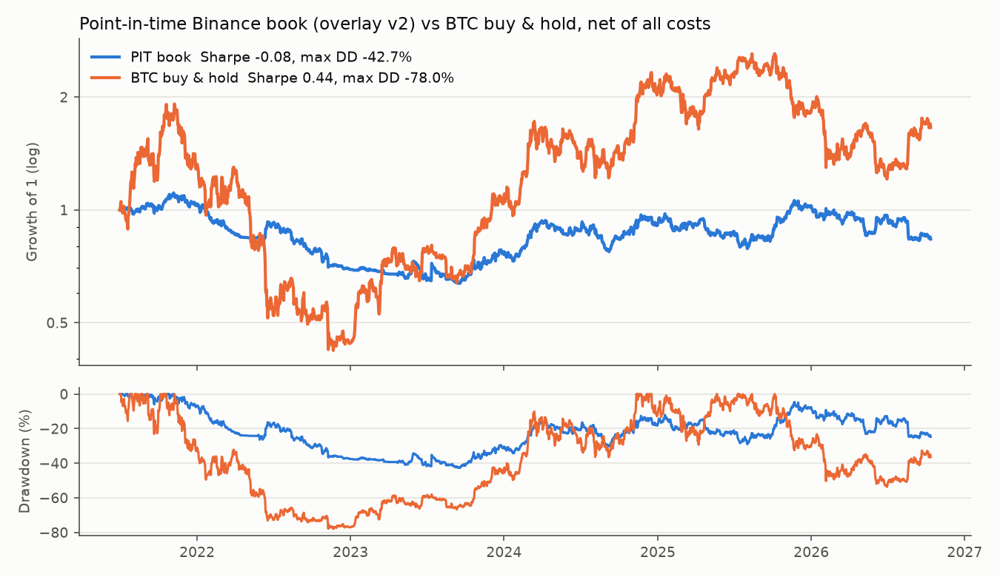
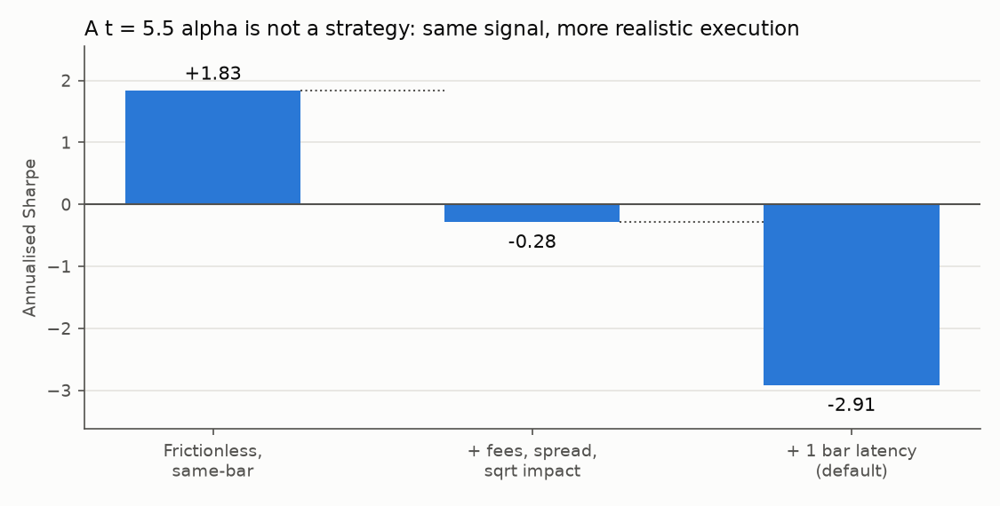
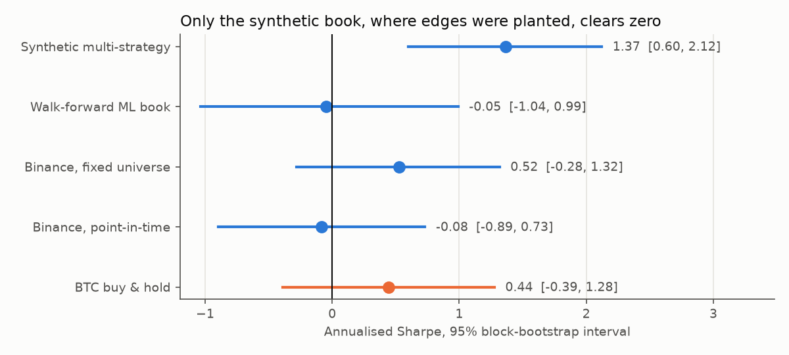

# AlphaForge

[](https://github.com/theojoyerclement-crypto/alphaforge/actions/workflows/ci.yml)  

**[Open an example HTML report](https://theojoyerclement-crypto.github.io/alphaforge/)** · [Results](docs/RESULTS.md) · [Methodology](docs/METHODOLOGY.md) · [Architecture](docs/ARCHITECTURE.md) · [Usage](docs/USAGE.md) · 🇫🇷 [Français](README.fr.md)

AlphaForge is a crypto quant research framework built to answer *"is this edge real, and does it
survive execution?"* rather than *"what would it have earned?"*. It takes Binance perpetuals
from causal features through multiple-testing-aware alpha research, cost- and funding-aware
backtests and walk-forward ML to a paper-trading loop that runs the backtest's own code. Every
published number comes from a seeded config, portfolio Sharpe ratios come with confidence
intervals, and method changes are pre-registered in git before their results are computed.



## Three conclusions

**1. A statistically significant alpha is not a strategy.** A 1-bar reversal alpha with
t = 5.5 earns Sharpe +1.83 frictionless, −0.28 after fees, spread and square-root impact, and
−2.91 once one bar of latency is added.



**2. On real data, nothing here beats BTC in a way that can be trusted.** The point-in-time
Binance book (monthly top 12 by trailing liquidity, one delisted coin included) has Sharpe
−0.08 [−0.89, 0.73] against 0.44 [−0.39, 1.28] for BTC buy & hold. No real-data Sharpe
excludes zero at 95%; only the synthetic book, where edges were planted, does.



**3. Honest checks found real bugs, and the fixes are published with their impact.**
- A risk-parity solver that silently diverged: synthetic portfolio Sharpe 0.65 → 1.37 once fixed.
- Binance serving flat placeholder candles after a delisting: now cleaned as a dead feed.
- A drawdown overlay that trapped the book at low exposure: fixed through a
  [pre-registered](docs/METHODOLOGY.md#6-pre-registered-change-drawdown-overlay-v2-2026-10-13)
  rule (mean exposure 0.24 → 0.89), with no claim that it adds Sharpe.

Full tables, caveats and reproduction commands: **[docs/RESULTS.md](docs/RESULTS.md)**.

## Where to start

| Look at | Why it matters | Where |
|---|---|---|
| **One command** | Tests, a reference backtest and a paper replay, offline, any OS | `python scripts/smoke_test.py` |
| **Anti-look-ahead tests** | The future is scrambled; features, strategies and portfolio construction must give the same past | `tests/test_features.py`, `tests/test_strategies.py`, `tests/test_portfolio.py` |
| **Accounting** | `net = gross + funding − costs`, checked against hand-computed books | `tests/test_backtest.py` |
| **Backtest ↔ paper parity** | The paper loop recomputes each decision from truncated history and matches backtest equity to 1e-10 | `src/alphaforge/live/`, `tests/test_live.py` |
| **Real data, bad results included** | Fixed vs point-in-time universe, overlay v1 vs v2, BTC benchmark | [RESULTS §5](docs/RESULTS.md#5-real-market-binance-usdt-m-perpetuals) |
| **Uncertainty** | Paired block-bootstrap intervals on every portfolio Sharpe | [RESULTS: noise](docs/RESULTS.md#how-much-of-this-is-noise) |
| **Pre-registration** | Rule committed before results (`cc2ba29` precedes `7a968bc`) | [METHODOLOGY §6](docs/METHODOLOGY.md#6-pre-registered-change-drawdown-overlay-v2-2026-10-13) |
| **Data quality** | Gaps, dead feeds, funding coverage, delistings | `alphaforge validate`, `src/alphaforge/data/quality.py` |
| **Docs never contradict results** | A README or figure number missing from RESULTS.md fails CI | `tests/test_docs.py` |

## Quickstart

macOS / Linux:

```bash
git clone https://github.com/theojoyerclement-crypto/alphaforge.git alphaforge && cd alphaforge
python3 -m venv .venv && source .venv/bin/activate
pip install -e ".[all]"
python scripts/smoke_test.py              # tests + reference backtest + paper replay
```

Windows (PowerShell). Use `python`, not `python3`, which is the Microsoft Store stub:

```powershell
git clone https://github.com/theojoyerclement-crypto/alphaforge.git alphaforge; cd alphaforge
python -m venv .venv; .venv\Scripts\Activate.ps1
pip install -e ".[all]"
python scripts/smoke_test.py
```

The smoke test prints the path of the HTML report (`runs/<timestamp>_multi_strategy/report.html`).
Individual commands:

```bash
alphaforge list                                         # strategies, features, alphas
alphaforge research configs/multi_strategy.yaml         # alpha leaderboard (BH, DSR)
alphaforge run configs/multi_strategy.yaml              # backtest + HTML report in runs/
alphaforge run configs/multi_strategy.yaml --set costs.fee_bps=2
alphaforge paper configs/multi_strategy.yaml --replay 20     # paper loop vs backtest parity
alphaforge validate configs/binance_perps_pit.yaml           # data-quality audit (real data)
python scripts/make_figures.py                          # regenerate the figures above
```

Real-data runs need public Binance data (no API key); the fetch commands are in
[RESULTS.md](docs/RESULTS.md#reproducing-the-real-data-tables).

## Project layout

```
src/alphaforge/   data · features · alpha · strategies · portfolio · backtest · ml · analytics · research · live · config · utils
configs/          multi_strategy · ml_walk_forward · cost_stress · binance_perps · binance_perps_pit
docs/             RESULTS · METHODOLOGY · ARCHITECTURE · USAGE · img/
scripts/          smoke_test.py · make_figures.py
examples/         quickstart · alpha research · ML meta-labeling · custom strategy · Sharpe confidence
tests/            causality properties, hand-computed accounting, CV leakage, paper parity, docs consistency
```

How it works, configuration, paper trading and writing a strategy: [docs/USAGE.md](docs/USAGE.md)
and [CONTRIBUTING.md](CONTRIBUTING.md).

## Roadmap

- Faster engine kernel (numba) with a parity test against the Python reference
- Exchange testnet broker behind the existing `Broker` interface: idempotent orders, reconciliation, kill switch
- Longer or broader real-data samples: five years of daily data cannot separate the books tested here
- Delisted-instrument history from a second source, to remove the survivorship that remains

## License and disclaimer

[MIT](LICENSE). Research software, not investment advice. The real-data results are a single,
survivorship-reduced backtest, not a track record.
