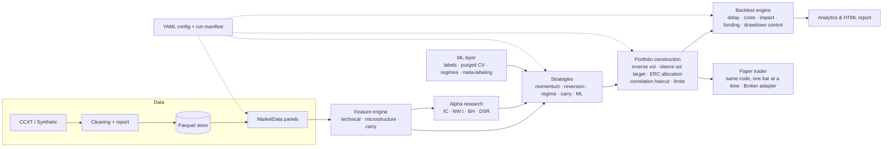

# Using AlphaForge

Detail moved out of the README: why the framework exists, paper trading, the Python API,
architecture, configuration and extension. Results live in [RESULTS.md](RESULTS.md).

## Why this exists

Most retail backtesters answer *"what would this strategy have earned?"*. AlphaForge is built to
answer the question a research desk actually asks: **"is this edge real, and does it survive
contact with execution?"** In practice, that means:

| Failure mode of naive backtests | How AlphaForge prevents it |
|---|---|
| Look-ahead bias | Every feature and rule-based strategy is **property-tested for causality**: the future is scrambled and the past must not change (`tests/test_features.py`, `tests/test_strategies.py`). |
| Same-bar execution | Signals at close *t* trade at close *t + delay* (`execution_delay: 1` by default). |
| Frictionless fills | Fees + half-spread + **square-root market impact** scaled by volatility and ADV; **perpetual funding** charged bar by bar. |
| Turnover measured on targets | Turnover is measured against **drifted** weights, which is what actually has to be traded. |
| Unfinished bars | The still-forming exchange candle is dropped at ingestion, so it never gets cached as a final close. |
| In-sample ML | Strategies that learn are **refused** outside walk-forward; each fold builds fresh models. |
| Label leakage in CV | **Purged K-fold + embargo** and **combinatorial purged CV** (López de Prado). |
| Data snooping across many alphas | **Newey-West** IC t-stats, **Benjamini-Hochberg** FDR control, **Deflated Sharpe Ratio**. |
| Backtest code ≠ live code | The paper trader calls the same strategies, portfolio constructor, cost model and mark-to-market function as the engine, and a test checks that both give the same equity. |
| Irreproducible results | Every run writes its resolved config, config hash, data hash, git commit (plus a dirty-tree flag), seed and package versions. |

## Paper trading

```bash
alphaforge paper configs/multi_strategy.yaml --replay 20    # offline demo + parity check
alphaforge paper configs/binance_perps.yaml                 # one live step on fresh data
```

`PaperTrader` (`src/alphaforge/live/`) runs the backtest's own strategies, `PortfolioConstructor`
and drawdown overlay on data up to the latest **closed** bar. It then trades the target decided
`execution_delay` bars ago through a `Broker`.

* `--replay N` walks the last N bars one at a time. At each bar it sees only the past, as it
  would live, and it fails if the resulting NAV differs from `BacktestEngine` over the same bars.
* The default mode is one step per call, meant to be scheduled once per bar (cron or Task
  Scheduler). It refreshes the data, marks the account to market, trades, and appends to
  `paper/<experiment>/{state.json, fills.csv, equity.csv}`. A second call on the same bar does
  nothing.
* `PaperBroker` fills at the close with the backtest's cost model. `CcxtTestnetBroker`
  implements the same `Broker` interface against an exchange sandbox
  (`--broker ccxt-testnet`, see [LIVE_TESTNET.md](LIVE_TESTNET.md)). Nothing upstream changes. Strategies that learn are not supported yet, because they
  need persisted, versioned models.

## Python API

```python
from alphaforge.config import load_config
from alphaforge.research import run_experiment

result = run_experiment(load_config("configs/multi_strategy.yaml"))
print(result.summary())                    # portfolio + every sleeve
result.portfolio.pnl_attribution()         # price vs funding vs costs
result.targets.allocation.tail()           # time-varying risk-parity weights
```

Worked examples live in [`examples/`](../examples): quickstart, alpha research, ML with purged CV and
meta-labeling, and writing your own strategy in about 20 lines.

## Architecture



| Package | Responsibility |
|---|---|
| `alphaforge.data` | CCXT ingestion (OHLCV + funding, paginated, retried, unfinished bar dropped), synthetic market generator, auditable cleaning, Parquet store with hashed metadata, aligned `MarketData` panels |
| `alphaforge.features` | Registry of 21 causal features: momentum, volatility estimators (Parkinson, Garman-Klass), RSI, efficiency ratio; microstructure proxies (Amihud, Roll, Corwin-Schultz, Kyle λ, close-location); funding and basis carry |
| `alphaforge.alpha` | 15-alpha library, rank IC and decay, quantile spreads, turnover, Newey-West, PSR/DSR, MinTRL, Benjamini-Hochberg, causal IC-weighted alpha combination |
| `alphaforge.strategies` | `ts_momentum`, `xs_momentum`, `zscore_reversion`, `st_reversal`, `regime_switching`, `funding_carry`, `alpha_composite`, `ml_directional`, `meta_labeled`, `ml_regime` |
| `alphaforge.portfolio` | EWMA risk, inverse-vol sizing, ex-ante volatility targeting, ERC risk parity, correlation haircut, position/gross/net limits, drawdown controller, fractional Kelly |
| `alphaforge.backtest` | Event-loop engine, linear and square-root impact cost models, walk-forward runner, purged & combinatorial purged K-fold |
| `alphaforge.ml` | Fixed-horizon and triple-barrier labels, pooled LightGBM/sklearn direction model, meta-labeling with bet sizing, GMM and volatility regimes |
| `alphaforge.analytics` | Sharpe, Sortino, Calmar, profit factor, VaR/CVaR, tail ratio, drawdown episodes, monthly table, plots, self-contained HTML report |
| `alphaforge.research` | `run_experiment` / `run_alpha_research`: config → results directory with manifest |
| `alphaforge.live` | `PaperTrader`, the `Broker` interface and `PaperBroker`: the research code driving an account bar by bar, with state that survives restarts |

## Configuration

One YAML file describes an experiment end to end. Unknown keys are rejected, so typos fail loudly
and the error message lists the valid keys. Strategy names and parameters are checked before any
data is downloaded.

```yaml
name: multi_strategy
data:      {source: synthetic, symbols: [BTC, ETH, SOL, ...], timeframe: 1d}
strategies:
  - {name: ts_momentum, params: {lookbacks: [20, 60, 120]}}
  - {name: funding_carry, params: {lookback: 21, quantile: 0.3}}
portfolio: {allocation: risk_parity, sleeve_target_vol: 0.15, target_vol: 0.20, max_position: 0.30}
risk:      {max_drawdown: 0.30, drawdown_soft_limit: 0.15, cooldown_bars: 20}
costs:     {model: sqrt_impact, fee_bps: 4.0, half_spread_bps: 1.5, impact_coefficient: 0.1}
backtest:  {execution_delay: 1, apply_funding: true, start: "2019-07-01"}
walk_forward: {enabled: false, train_bars: 750, test_bars: 120, embargo_bars: 10}
```

```text
$ alphaforge run my.yaml
error: my.yaml: 1 invalid setting(s)
  - portfolio.target_volatility: unknown key (allowed: vol_halflife, sleeve_target_vol, allocation, ..., target_vol, ...)
```

Each run writes `runs/<timestamp>_<name>/` containing `report.html`, `metrics.csv/json`,
`pnl_attribution.csv`, `drawdowns.csv`, `monthly_returns.csv`, `allocation.csv`, time series and
positions, `cleaning_report.csv`, `config.json`, `manifest.json` and `run.log`.

## Extending

```python
from alphaforge.strategies import Strategy, register_strategy
from alphaforge.features import compute_feature

@register_strategy
class FundingSqueeze(Strategy):
    name, family = "funding_squeeze", "carry"

    def __init__(self, lookback: int = 7) -> None:
        self.lookback = lookback

    def generate_signals(self, data):
        funding = compute_feature("funding_rate", data, lookback=self.lookback)
        trend = compute_feature("vol_adj_momentum", data, lookback=30)
        return self.finalize(((funding < 0) & (trend > 0)) * 1.0, data)
```

The strategy is now usable from YAML (`- name: funding_squeeze`), and the causality and bounds
tests pick it up automatically. New features use `@register_feature` the same way. See
[CONTRIBUTING.md](../CONTRIBUTING.md).
